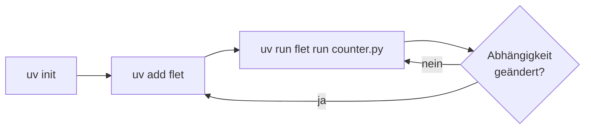

# uv-Workflow, Flet ausführen & Flet Studio

**P-Seminar „Entwicklung einer App" · Arbeitsblatt-Entwurf**

!!! info "Ziele der heutigen Sitzung"
    - Du kannst den **uv-Workflow** (`uv init → add → run → sync`) erklären und anwenden.
    - Du kennst **vier Wege, eine Flet-App zu starten** (alle über uv bzw. den Browser) und weißt, wann jeder sinnvoll ist — inklusive Test auf dem eigenen **Smartphone per QR-Code**.
    - Du hast eine erste App im **Flet Studio** im Browser laufen lassen und geteilt.

!!! tip "Voraussetzungen"
    VS Code (lokal oder Codespace), uv ist installiert (`uv --version` zum Prüfen), Repo des P-Seminars ist geclont.

---

## Unsere Beispiel-App für heute

Alle Aufgaben heute nutzen dieselbe minimale App. Lege sie als `counter.py` ab:

```python
import flet as ft


def main(page: ft.Page):
    counter = ft.Text("0", size=50, data=0)

    def increment(e):
        counter.data += 1
        counter.value = str(counter.data)
        page.update()

    page.add(
        ft.Container(content=counter, alignment=ft.alignment.CENTER, expand=True),
        ft.FloatingActionButton(icon=ft.Icons.ADD, on_click=increment),
    )


ft.run(main)
```

---

## Teil 1: Der uv-Workflow im Detail

!!! abstract "Merksatz"
    `pyproject.toml` beschreibt, **was** das Projekt braucht (und du pflegst es über `uv add`).
    `uv.lock` legt fest, **welche exakten Versionen** gemeint sind (uv verwaltet die Datei, nie von Hand ändern!).
    `.venv/` ist der lokale Baukasten, der aus beidem erzeugt wird — gehört **nicht** ins Git.

**Der typische Zyklus:**



**Die vier Kommandos, die du brauchst:**

| Kommando | Wirkung |
|---|---|
| `uv init` | Legt Projekt an: `pyproject.toml`, `.python-version`, `README.md` |
| `uv add flet` | Trägt `flet` in `pyproject.toml` ein, aktualisiert `uv.lock`, installiert ins `.venv` |
| `uv run …` | Sichert vor jedem Start zu, dass das Environment zum Lockfile passt, und führt dann aus |
| `uv sync` | Richtet das Environment komplett nach `uv.lock` ein (z. B. nach `git pull` auf einem anderen Rechner) |

!!! note "Warum läuft `uv run` jedes Mal so schnell los?"
    `uv run` prüft still und synchronisiert: Lockfile aktuell? Environment aktuell? Fehlt etwas, wird in Sekundenbruchteilen nachinstalliert. Deshalb erst **absichtlich** `uv sync`, wenn du das Environment bewusst neu aufbauen willst.

---

## Teil 2: Vier Wege, eine Flet-App zu starten — alles mit uv

=== "A · Als Desktop-App (Standard)"

    ```bash
    uv run flet run counter.py
    ```

    Flet öffnet ein **eigenes Fenster** (Flutter-Desktop-Runtime). Das ist der normale Weg während der Entwicklung.

=== "B · Als Web-App im Browser"

    ```bash
    uv run flet run counter.py --web
    ```

    Flet startet einen **lokalen Webserver**; die App läuft im Browser statt im eigenen Fenster. Genau so wird unsere Seminar-App später auch im Web ausgeliefert. Läuft der Rechner im Schul-WLAN, könnt ihr die App mit der angezeigten IP auch **vom Smartphone** aus testen — echte Geräte früh einbeziehen!

=== "C · Live auf dem Handy — mit QR-Code"

    Einmalig: die kostenlose **„Flet"-App** aus dem Play Store (bzw. App Store) installieren.
    Handy und Rechner müssen im selben WLAN sein, dann:

    ```bash
    uv run flet run --android counter.py     # iOS: --ios
    ```

    **Im Terminal erscheint automatisch ein QR-Code** mit der Projekt-URL. Mit der Handy-Kamera scannen, Link antippen — die App läuft live auf dem Smartphone, **inklusive Hot Reload**: Code ändern, speichern, Handy aktualisiert sofort. Perfekt, um die Seminar-App auf echten Geräten zu testen.

=== "D · Gar nichts installiert: Flet Studio"

    1. Öffne `flet.dev/studio` im Browser.
    2. Wähle ein Beispiel aus der Gallery (500+ Apps) und klicke **Run**.
    3. Fork es und ändere etwas.

    Der Python-Code läuft per **Pyodide (Python als WebAssembly) komplett im Browser**, nicht auf einem Server. Kein Account nötig zum Ausprobieren.

!!! abstract "Hot Reload — der Komfort-Faktor"
    `flet run` startet die App im **Hot-Reload-Modus**: Läuft die App weiter und du speicherst eine Code-Änderung, aktualisiert sich die laufende App automatisch — **Status bleibt erhalten**, wo möglich. Das gilt für Desktop-Fenster und `--web` gleichermaßen.

    1. Starte `counter.py` und klicke ein paarmal, zähle auf 5.
    2. Ändere im Editor die Schriftgröße (`size=50` → `size=80`) und speichere — **ohne** die App neu zu starten.
    3. Beobachte: Was übernimmt die laufende App sofort, was wird zurückgesetzt? Wann musst du doch neu starten?

!!! question "Aufgabe 2 (10 min)"
    Probiere **mindestens drei der vier Wege** mit der Counter-App aus.

    1. Notiere für jeden Weg: Was musstest du **vor** dem ersten Start tun? Was passiert beim Start?
    2. Mache dabei die Hot-Reload-Beobachtungen aus der Box oben.
    3. Tragt eure Ergebnisse in die Tabelle ein (Kopiervorlage in deiner Doku im Repo):

    | Weg | Wo läuft die App? | Hot Reload? | Geeignet für… |
    |---|---|---|---|
    | A Desktop (`flet run`) |  |  |  |
    | B Web (`--web`) |  |  |  |
    | C Handy per QR-Code (`--android`) |  |  |  |
    | D Flet Studio |  |  |  |

---

## Teil 3: Flet Studio

!!! info "Fakten zu Flet Studio (Stand: Nov. 2026)"
    - Browser-IDE für Flet: **Gallery mit 500+ Beispiel-Apps**, fork-and-play, Versionshistorie, Share-Link.
    - Code läuft via **Pyodide im Browser**, nicht auf Flet-Servern — nur die Projektverwaltung (Speichern, Account) liegt im Backend.
    - Für robuste Multi-Datei-Projekte, Desktop-/Mobile-Builds und die volle Python-Paketvielfalt bleibt **lokale Entwicklung** mit `flet run`/`flet build` das Mittel der Wahl.
    - Anmelden nötig für: Projekte speichern + KI-Agent. Nur ausprobieren geht ohne Account.

---

## Tafelbild / Merkzettel fürs Plenum

- **uv in einem Satz:** „Pyproject sagt was, Lockfile sagt exakt, `.venv` macht's — und `uv run` kümmert sich um alles."
- **Wohin läuft die App?** Fenster: `flet run` · Browser: `--web` · Handy: `--android` + QR-Code · Browser remote: Flet Studio
- **Git:** `pyproject.toml`, `uv.lock`, `.python-version` **rein** · `.venv/` **raus**